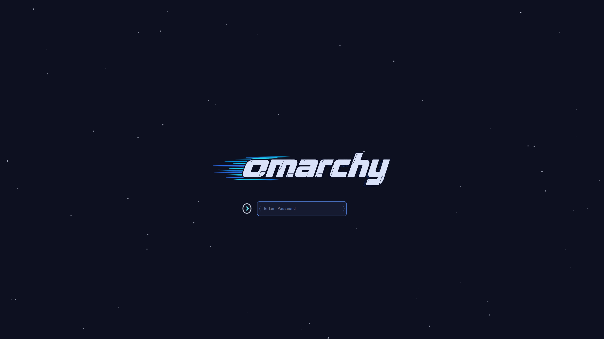

# Starfall — Omarchy boot & lock screen

A matching boot screen and lock screen for [Omarchy](https://omarchy.org/). A deep-navy night sky with twinkling stars, an occasional shooting star, and a speed-streaked `omarchy` wordmark above the password field.

- **Boot screen** (`starfall/`): a [Plymouth](https://www.freedesktop.org/wiki/Software/Plymouth/) theme shown at power-on, where you unlock your encrypted disk, and on shutdown.
- **Lock screen** (`lock/`): an Omarchy shell plugin that replaces the stock lock screen.

Install either one or both.


## Features

- Night-sky background (`#0D1020`) with 60 randomly placed stars that twinkle at their own pace
- A shooting star that crosses the upper sky every 5–9 seconds
- Custom `omarchy` wordmark, password field, prompt icon, and cyan password dots
- Cyan progress bar after the disk is unlocked
- Also shown on shutdown and reboot

## Boot screen

### Requirements

- Omarchy (Arch Linux + Limine bootloader)
- Plymouth enabled (default on Omarchy)

### Install

1. Clone the repo:

   ```bash
   git clone https://github.com/dioannou30/omarchy-starfall-boot.git
   cd omarchy-starfall-boot
   ```

2. Copy the theme into Plymouth's theme folder:

   ```bash
   sudo cp -r starfall /usr/share/plymouth/themes/starfall
   ```

3. Make it the default theme:

   ```bash
   sudo plymouth-set-default-theme starfall
   ```

4. Rebuild the boot image. This step is required: at power-on the disk is still encrypted, so Plymouth loads the theme from the boot image, not from `/usr/share`.

   ```bash
   sudo limine-mkinitcpio
   ```

5. Reboot.

### Update

Pull the latest version and repeat steps 2 and 4:

```bash
git pull
sudo rm -rf /usr/share/plymouth/themes/starfall
sudo cp -r starfall /usr/share/plymouth/themes/starfall
sudo limine-mkinitcpio
```

### Uninstall

Restore the stock Omarchy boot screen:

```bash
omarchy plymouth reset
sudo rm -rf /usr/share/plymouth/themes/starfall
```

### Customizing

| File | What it is |
|---|---|
| `logo.png` | Wordmark, 800×188 |
| `entry.png` | Password field, 286×48 |
| `lock.png` | Prompt icon, 84×96 (shown at ~34×38) |
| `bullet.png` | Password dot, 14×14 (shown at 7×7) |
| `progress_box.png` / `progress_bar.png` | Progress bar track and fill, 300×10 |
| `star.png` | Star, 6×6 |
| `streak.png` | Shooting-star trail, 120×4 |
| `starfall.script` | Layout, colors, and animation |

Background color is set by `Window.SetBackgroundTopColor` / `SetBackgroundBottomColor` at the top of `starfall.script`. Star count, twinkle speed, and shooting-star timing live in the `star.*` and `streak.*` variables right below it. After any change, copy the folder again and rebuild the boot image.

## Lock screen



Same night sky and wordmark, with smooth twinkling stars, a shooting star every few seconds, cyan password dots, and a shake on a wrong password. Password, fingerprint, and session handling are unchanged from the stock Omarchy lock screen.

### Install

1. Copy the plugin into your Omarchy plugins folder (from the cloned repo):

   ```bash
   cp -r lock ~/.config/omarchy/plugins/starfall.lock
   ```

2. Swap it in for the stock lock screen and restart the shell:

   ```bash
   omarchy plugin disable omarchy.lock
   omarchy plugin enable starfall.lock
   omarchy restart shell
   ```

3. Try it:

   ```bash
   omarchy system lock
   ```

### Update

```bash
git pull
rm -rf ~/.config/omarchy/plugins/starfall.lock
cp -r lock ~/.config/omarchy/plugins/starfall.lock
```

Changes reload automatically.

### Uninstall

```bash
omarchy plugin disable starfall.lock
omarchy plugin enable omarchy.lock
omarchy restart shell
rm -rf ~/.config/omarchy/plugins/starfall.lock
```

### Notes

- If the lock screen ever fails to show or won't accept input, switch to a text console (`Ctrl+Alt+F3`), log in, and run the Uninstall commands above (you can skip the last `rm` line) to get the stock lock screen back.
- The look lives in `lock/LockView.qml`: colors are the `skyColor`, `textColor`, `dotColor`, `placeholderColor`, and `errorColor` properties at the top; star count is the `Repeater` model. Saving the installed copy reloads it live.
- `lock/Service.qml` is the stock Omarchy lock service. Future Omarchy updates to the stock lock screen will not reach this copy.
